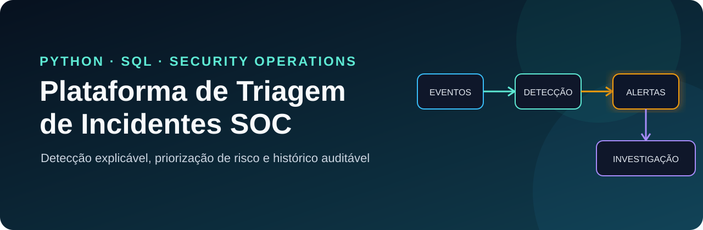

<div align="center">

# Plataforma de Triagem de Incidentes SOC


</div>

Projeto de portfólio em Python e SQL que transforma logs fictícios de autenticação em alertas priorizados e casos de investigação com histórico auditável.

> **Papel no portfólio:** evolução integrada do [Analisador de Logs de Segurança](https://github.com/NicolasMarquesSousa/analisador-logs-seguranca) e do [Banco de Incidentes de Segurança](https://github.com/NicolasMarquesSousa/banco-incidentes-seguranca). Este projeto conecta ingestão, detecção, persistência e acompanhamento operacional em um único fluxo.

## Problema resolvido

Equipes de segurança recebem muitos eventos de autenticação e precisam separar rapidamente atividades normais de comportamentos que exigem investigação. A aplicação:

- importa e valida eventos de um arquivo CSV;
- normaliza usuários, equipamentos, horários e endereços IP;
- detecta comportamentos suspeitos com regras explicáveis;
- calcula pontuações de risco;
- armazena eventos e alertas em SQLite sem duplicação;
- prioriza a fila de alertas;
- acompanha o ciclo de vida do incidente;
- registra analista, observação e horário de cada decisão.

Todos os dados de demonstração são fictícios.

## Fluxo

```text
Logs CSV fictícios
        │
        ▼
Validação e normalização
        │
        ▼
Regras de detecção e pontuação de risco
        │
        ▼
SQLite ── auth_events
   │    ├─ alerts
   │    └─ alert_history
   ▼
Resumo, fila priorizada e histórico do caso
```

## Regras de detecção

| Regra | Critério | Severidade | Contexto |
|---|---|---:|---|
| `BRUTE_FORCE` | Cinco ou mais falhas do mesmo IP em até dez minutos | Alta | MITRE ATT&CK T1110 |
| `SUCCESS_AFTER_FAILURES` | Login bem-sucedido após três ou mais falhas recentes | Crítica | Possível comprometimento de conta |
| `OFF_HOURS_LOGIN` | Login bem-sucedido entre 22h e 6h | Média | Anomalia de contexto |

Cada alerta guarda uma evidência legível para que o analista entenda por que a regra foi acionada.

## Ciclo da investigação

```text
open → investigating → resolved
```

Cada mudança registra:

- status anterior e novo status;
- nome do analista;
- observação da investigação;
- data e horário em UTC.

Esse histórico evita que decisões sejam sobrescritas sem rastreabilidade.

## Como executar

Requer Python 3.11 ou superior e não utiliza dependências externas em tempo de execução.

### Windows PowerShell

```powershell
$env:PYTHONPATH="src"
python -m soc_triage.cli ingest data/sample_auth_events.csv --database soc_triage.db
python -m soc_triage.cli summary --database soc_triage.db
python -m soc_triage.cli alerts --database soc_triage.db
```

### Linux e macOS

```bash
export PYTHONPATH=src
python -m soc_triage.cli ingest data/sample_auth_events.csv --database soc_triage.db
python -m soc_triage.cli summary --database soc_triage.db
python -m soc_triage.cli alerts --database soc_triage.db
```

## Registrar uma investigação

Assumir um alerta:

```powershell
python -m soc_triage.cli status 2 investigating --analyst "Nicolas Marques" --note "Validando IP de origem e linha do tempo" --database soc_triage.db
```

Concluir a análise:

```powershell
python -m soc_triage.cli status 2 resolved --analyst "Nicolas Marques" --note "Atividade simulada confirmada; nenhuma contenção necessária" --database soc_triage.db
```

Consultar o alerta e todo o histórico:

```powershell
python -m soc_triage.cli case 2 --database soc_triage.db
```

## Testes automatizados

```powershell
python -m unittest discover -s tests -v
```

A suíte cobre validação do CSV, regras de detecção, prevenção de falso positivo, ordenação por risco, mudança de status, alertas inexistentes e trilha de auditoria.

Resultado validado: **7 testes aprovados**. O GitHub Actions executa a mesma suíte automaticamente em Linux.

## Decisões técnicas

- **SQL parametrizado:** valores não são concatenados às consultas.
- **Restrições `UNIQUE`:** reprocessar o mesmo arquivo não duplica dados.
- **Chaves estrangeiras:** relacionam o histórico ao alerta correspondente.
- **Horários em UTC:** mantêm consistência entre localidades.
- **SQLite em memória nos testes:** garante isolamento e repetibilidade.
- **Dados fictícios:** nenhuma informação pessoal, corporativa ou confidencial é publicada.

## Estrutura

```text
data/                       eventos fictícios de autenticação
src/soc_triage/parser.py    leitura, validação e normalização
src/soc_triage/rules.py     regras e pontuação de risco
src/soc_triage/database.py  persistência e trilha de auditoria
src/soc_triage/cli.py       comandos da aplicação
tests/                      testes automatizados
```

## Tecnologias e conceitos

Python · SQL · SQLite · Git · GitHub Actions · Linux · SOC · triagem de incidentes · engenharia de detecção · MITRE ATT&CK · testes automatizados

## Próximas evoluções

- API REST com FastAPI;
- dashboard operacional;
- filtros por severidade, status, usuário e período;
- enriquecimento local de reputação de IPs;
- Docker e PostgreSQL;
- relatório executivo em Power BI.

## English summary

An explainable SOC incident triage project that validates fictional authentication logs, detects suspicious behavior, prioritizes alerts and preserves an auditable investigation history. Built with Python, SQL, SQLite, automated tests and GitHub Actions.

## Privacidade e segurança

- Não publique logs reais, segredos ou credenciais.
- Os nomes e endereços IP da amostra são fictícios ou reservados para documentação.
- O projeto é educacional e não substitui um SIEM corporativo.

---

Desenvolvido por [Nicolas Marques](https://github.com/NicolasMarquesSousa) · [Ver portfólio](https://github.com/NicolasMarquesSousa)
